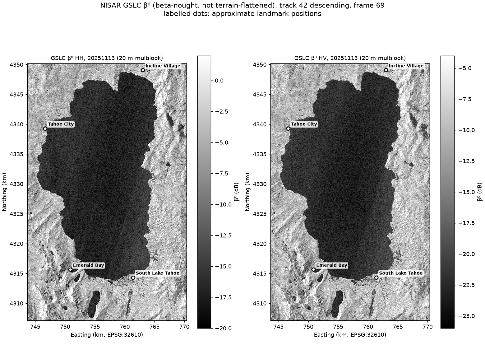
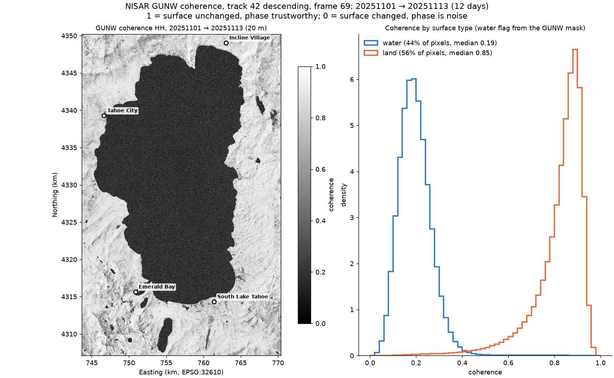
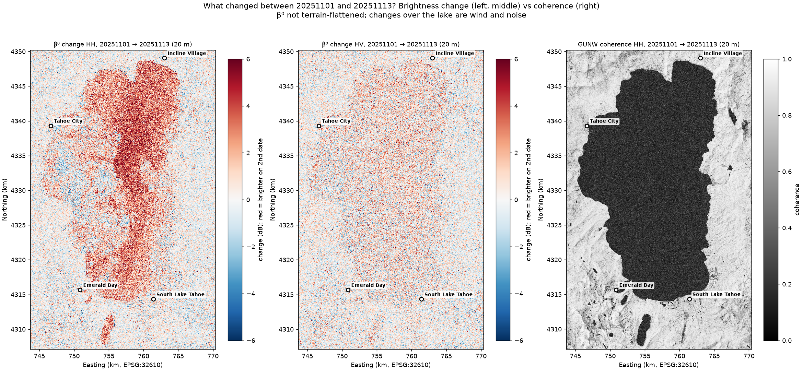

# NISAR over Lake Tahoe: initial data exploration

**Date:** 2026-10-21
**Status:** exploration only, no modelling. Code and data paths are in this repository.

---

## 1. Summary

- I found, downloaded and checked one **matched set of NISAR L-band products** over Lake Tahoe:
  two GSLC images (2025-11-01 and 2025-11-13) and the GUNW interferogram between them (track 42,
  descending, frame 69, PROVISIONAL processing).
- I built a small, reproducible pipeline (`run_eda.py`) that produces backscatter (β⁰) maps for both
  dates, a **coherence map**, and a **brightness-change map**, with summary tables.
- **Main results:** land stayed very stable over the 12 days (median coherence **0.85**, median
  brightness change **≈ 0 dB**). The lake has no usable phase (median coherence **0.19**), and it
  turned brighter on Nov 13 (≈ +1.6 dB in HH), most likely from wind roughening the water.
- I have questions about the research direction (especially **wildfire fuel loads**) and the lab's
  tools before going further. See §6.

---

## 2. Data

| Product | Date(s) | What it contains | Local files |
|---|---|---|---|
| GSLC (L2) | 2025-11-01, 2025-11-13 | complex image per date, 5 m pixels, HH + HV | `data/gslc_<date>_freqA_{HH,HV,mask}.tif` |
| GUNW (L2) | 2025-11-01 → 11-13 | wrapped interferogram, coherence, mask (20 m); unwrapped phase, coherence, connected components, mask (80 m); HH only | `data/gunw_20251101_20251113_*.tif` |

**Why these products:** same track, frame, flight direction, frequency, and processing version
(CRID `P05023`), so the two dates see the ground from the same geometry and can be compared pixel by
pixel. These were the earliest 2025 dates available. The full catalog search (320 products, 2025–2026)
is in `outputs/scene_inventory_all.csv`.

**How:** the full products are large (GSLC ≈ 23 GB, GUNW ≈ 2.3 GB). So I used GDAL
(`gdal_translate -projwin`) to read only the Lake Tahoe area directly from NASA's server and save it
as GeoTIFFs (≈ 860 MB in total). This tool copies the original pixels without resampling, which
matters because resampling would corrupt the complex values. Exact commands and checks are in
`DATA_ACCESS.md`.

**Area:** whole lake, about 27 × 43 km (lon −120.18 to −119.88, lat 38.88 to 39.26), UTM zone 10N.

---

## 3. What I did

1. Converted each GSLC pixel from a complex value to backscatter power β⁰ = |z|², masked invalid
   pixels, and displayed it in dB.
2. Averaged 4 × 4 pixels (5 m → 20 m) for display, to reduce speckle. I always averaged in power,
   never in dB or complex values.
3. Computed percentiles per date and polarization (`outputs/gslc_stats.csv`).
4. Mapped GUNW coherence and split it into land and water using the GUNW mask's water flag
   (`outputs/gunw_coherence_stats.csv`).
5. Mapped the β⁰ change Nov 1 → Nov 13 (dB) for HH and HV, next to coherence
   (`outputs/gslc_change_stats.csv`).

Everything is reproduced by one command: `.venv/bin/python run_eda.py`.

---

## 4. Results

### 4.1 Backscatter (β⁰), Nov 13

The lake is dark (smooth water reflects the pulse away from the radar). Mountains and town are bright.
HV is about 6 dB weaker than HH everywhere, which is normal.

| | HH median | HV median |
|---|---|---|
| Nov 1 | −13.3 dB | −18.6 dB |
| Nov 13 | −12.6 dB | −18.4 dB |

### 4.2 Coherence, Nov 1 → Nov 13

| | Share of area | Median coherence |
|---|---|---|
| Land | 56 % | **0.85** |
| Water | 44 % | **0.19** |

- Land is highly coherent, so the surface changed very little in 12 days.
- Water is near the noise level. Coherence estimated from a small window never reaches exactly 0,
  so I treat values below about 0.3 as "no usable phase".
- In the GUNW, connected component `0` matches the water flag on 98.7 % of pixels. This suggests
  `0` = "not unwrapped (water)", but I have not found it confirmed in the documentation.

### 4.3 Brightness change, Nov 1 → Nov 13

- **Land:** median change ≈ 0 dB (middle 50 % within about ±0.9 dB, mostly residual speckle). No large
  changed areas are visible.
- **Lake:** brighter on Nov 13, in large streaky patches (≈ +1.6 dB in HH, +0.5 dB in HV; from a
  rough brightness-based water split). I interpret this as wind roughening the water surface.
- Read together: low coherence + no brightness change suggests things moved around without changing
  overall (e.g. wind in trees); low coherence + brightness change suggests the surface itself changed
  (e.g. wetness, snow, removal).

---

## 5. What I learned

- **NISAR** is a radar satellite: it sends microwave pulses (L-band, ~24 cm wavelength) and records the
  echo. It works day and night and through clouds, and repeats the same path every 12 days.
- **Backscatter (brightness)** = how much of the pulse comes back. Smooth water is dark, rough or
  vegetated surfaces are brighter, and buildings (wall–ground corners) are very bright.
- **Each GSLC pixel is a complex number** (an arrow): its length is the echo strength, its angle (phase)
  is where in the wave cycle the echo arrived. β⁰ = |z|², shown as 10·log₁₀(β⁰) dB.
- **Average power, never complex values:** the phases of neighbouring pixels are random, so averaging
  complex values makes them cancel and the image becomes artificially dark.
- **Phase is useful only when comparing two dates** from the same geometry (GUNW): the phase difference
  reflects ground motion toward or away from the radar, and **coherence** (0–1) says whether that
  phase is trustworthy, i.e. how much the surface stayed the same.
- **HH vs HV:** HH responds to surfaces and corners; HV comes mostly from volume scattering in
  vegetation, so it is most related to how much vegetation there is.
- **β⁰ vs σ⁰ vs γ⁰:** the same echo power normalized by different reference areas. My maps use β⁰
  (not terrain-flattened), so slopes facing the radar look bright because of their tilt. Terrain-
  flattened γ⁰ (the GCOV product) removes most of this effect.
- **Track, frame, ascending/descending:** the radar looks sideways, so different tracks see mountain
  slopes from opposite sides. Only same-track pairs can be compared pixel by pixel.
- **File formats and tools:** NISAR products are HDF5 (many arrays plus metadata in one file);
  GeoTIFF is one map layer plus its location (CRS and pixel grid). GDAL is the standard tool to cut and
  convert them; ASF is the NASA archive that hosts NISAR data.

---

## 6. Questions for Amber

1. **Research direction:** how could GSLC and GUNW (coherence, phase) help identify **fuel loads** and assess
   **wildfire risk**? 
2. **Lab tools:** does the lab have a **GitHub repository** or standard scripts for analysing and
   visualising NISAR data that I should use instead of, or alongside, my own?
3. **Study area:** should I focus on a specific region (e.g. a forested area) rather than the whole lake,
   and does it need to match a particular research goal or ground data?
4. **HH vs HV:** how is the difference between HH and HV best visualized? In my plots the two
   polarizations look quite similar, so I didn't notice much difference.
5. **Data:**  what is the difference between PROVISIONAL and UNCALIBRATED datasets?